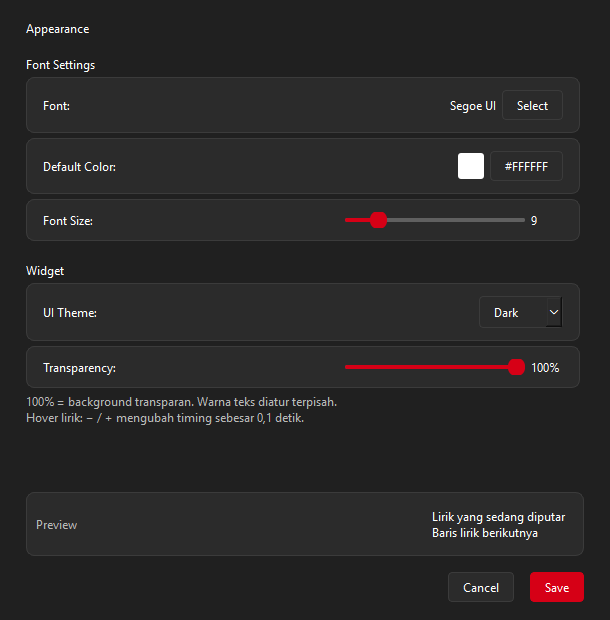

<p align="center">
  
</p>

# GlanceLyric

[](LICENSE)


**Read Spotify lyrics on your Windows taskbar while you work.**

GlanceLyric displays two lines of synchronized lyrics beside the system tray.
It reads Spotify's media session through Windows and fetches lyrics from
[LRCLIB](https://lrclib.net). You can use it independently of SpotX.

[Official website](https://ggdealstore.site/glancelyric) · [Source](https://github.com/ddmmyy94/GlanceLyric) · [Install](#install) · [Features](#features) · [Quick start](#quick-start) · [FAQ](#faq) · [Support](#support-glancelyric)

## Install

**Early Windows testing, v1.0.0.** Automated checks and a portable runtime check
have passed locally. Manual Windows installation, upgrade, uninstall, login
autostart, and live Spotify testing have not been completed. The first release
is intended for early testing, not a claim of full Windows validation.

Use only assets from [official GitHub Releases](https://github.com/ddmmyy94/GlanceLyric/releases).
If no assets appear there yet, publication is still in progress. GlanceLyric
remains free to download and use, with no donation required.

### Windows installer

In the official release, choose **`GlanceLyric-Setup-1.0.0-x64.exe`** and run it.
The installer installs the app for your Windows account, adds a Start Menu
shortcut, and offers optional desktop and autostart shortcuts/settings.
You do not need to install Python or run the installer as Administrator.

**Requirements:** Windows 10 version 1809 or newer, or Windows 11, on an x64 PC;
the Spotify desktop app; an internet connection to fetch uncached lyrics.

### Portable ZIP

Choose **`GlanceLyric-v1.0-windows-x64.zip`** from the same release, extract it,
and run `GlanceLyric.exe` inside the `GlanceLyric` folder. Keep `_internal` beside
the executable. The ZIP includes Python and Qt.

### WinGet (planned)

The package is **not yet available in the WinGet community repository**.
After the package submission is accepted, you will be able to install it with:

```powershell
winget install --id ddmmyy94.GlanceLyric --exact --source winget
```

Until then, use the official installer or portable ZIP when available in Releases.

## Features

- **Two-line synchronized lyrics** on the taskbar, with each pair staying in
  place until the next lyric block.
- **Windows media integration** for the Spotify desktop app, without a Spotify
  developer account or API key.
- **Appearance settings** for fonts, text size, colors, theme, and transparency.
- **Timing adjustment** in 0.1-second steps when the lyrics run early or late.
- **Optional autostart:** a background watcher opens the widget when a new
  Spotify process session starts.
- **Taskbar placement** to the left of the tray, with space for NetSpeedTray
  when GlanceLyric detects it.
- **Local settings and lyric cache** in `%USERPROFILE%\.glancelyric`.

### Screenshots




Application screenshots with sample lyrics, not a live Spotify playback session.

## Quick start

1. Launch **GlanceLyric** from the Start Menu or the extracted folder.
2. Play a song in the Spotify desktop app.
3. Right-click the widget and choose **Settings** to adjust its appearance.
4. Hover over the widget and use `+` / `−` to adjust lyric timing. You can also
   use `←` / `→`, hold `Shift` for 0.5-second steps, or press `Ctrl+0` to reset.
5. Choose **Exit** from the context menu to close the widget.

The autostart watcher respects **Exit** for the current Spotify process session.
Launch GlanceLyric yourself or restart Spotify to show it again.

## FAQ

### Do I need SpotX or Python?

No. The release packages include the runtime. GlanceLyric does not depend on a
SpotX installation.

### Does it work with Spotify in a browser?

Version 1.0 targets the Spotify desktop app. Browser playback is not supported.

### Why are some lyrics missing or out of sync?

LRCLIB may not have synchronized lyrics for a song, or its metadata may differ
from Spotify's. Use the timing controls for a fixed offset. An instrumental
track or a track without synchronized lyrics may not show timed lines.

### What data leaves my computer?

GlanceLyric reads the current Spotify media metadata and playback state from
Windows. To find lyrics, it sends song lookup metadata such as the title and
artist to LRCLIB over the internet. Settings and cached lyrics live in
`%USERPROFILE%\.glancelyric`. See the [privacy notes](PRIVACY.md).

### How do I enable or disable autostart?

Select the autostart task in the installer, or run these commands from the
folder containing `GlanceLyric.exe`:

```powershell
.\GlanceLyric.exe --install
.\GlanceLyric.exe --uninstall
```

The second command removes the autostart registration; it does not uninstall
the application. The change applies to subsequent Windows logins. To stop an
existing watcher immediately, end its GlanceLyric process in Task Manager.

### How do I uninstall it?

For the Setup edition, open **Windows Settings → Apps → Installed apps →
GlanceLyric → Uninstall**. Close the widget and stop its background watcher
before uninstalling. For the portable edition, disable autostart, close its
processes, and delete the extracted folder.

The uninstaller keeps `%USERPROFILE%\.glancelyric`. Delete that folder yourself
if you want to remove settings and cached lyrics too.

### Why might Windows show an unknown-publisher warning?

The current build configuration produces unsigned executables. Windows may
show a SmartScreen warning. Download releases from this project's GitHub
repository and check the release's SHA-256 hashes if supplied.

## Support GlanceLyric

GlanceLyric is free and open source. You can support the project by
[starring the repository](https://github.com/ddmmyy94/GlanceLyric),
[reporting a bug](https://github.com/ddmmyy94/GlanceLyric/issues), or contributing a fix.

[Support GlanceLyric on SociaBuzz](https://sociabuzz.com/ddmmyy94/tribe)

Donations are optional and are never required to download, install, or use the
app. SociaBuzz handles payments on its own website; no payment takes place in
GlanceLyric.

## Build from source

Use 64-bit Python compatible with the dependencies. The local v1.0 build used
Python 3.14. Install [Inno Setup 6.3 or newer](https://jrsoftware.org/isinfo.php)
if you also want to build `Setup.exe`.

Clone the source, then build:

```powershell
git clone https://github.com/ddmmyy94/GlanceLyric.git
cd GlanceLyric
.\Build.bat
.\.venv\Scripts\python.exe test_glance.py
.\.venv\Scripts\python.exe test_release.py
```

`Build.bat` creates a virtual environment, installs the dependencies, converts
`assets/glancelyric.png` into a multi-size ICO, and builds the executable and
portable ZIP. If it finds `ISCC.exe` on PATH or in a standard Inno Setup 6
installation directory, it builds the installer too. Output goes to `dist/`.
`test_release.py` checks both package hashes, ZIP integrity, notices, and the
README's bundled assets; it requires a completed installer and portable build.

To run from source after installing dependencies:

```powershell
.\.venv\Scripts\pythonw.exe glancelyric.pyw
```

See [RELEASING.md](RELEASING.md) for GitHub release, WinGet submission, and
donation setup instructions.

## Contributing

[Open an issue](https://github.com/ddmmyy94/GlanceLyric/issues) with your Windows version, GlanceLyric version, Spotify
version, and steps to reproduce the problem. For lyric problems, include the
song title and artist. Pull requests are welcome.

## Credits

- [LRCLIB](https://lrclib.net) for the lyric service.
- Python, PySide6 / Qt, Requests, PyWinRT, PyInstaller, and Inno Setup.
- [NetSpeedTray](https://github.com/erez-c137/NetSpeedTray) for taskbar-app and
  README presentation inspiration.
- GlanceLyric logo supplied by the project maintainer.

GlanceLyric is an independent project and is not affiliated with Spotify.

## License

GlanceLyric's application code is available under the [MIT License](LICENSE).
You may use, modify, and redistribute it, including commercially, while keeping
the required copyright and license notices. Dependencies retain their own
licenses; see [THIRD-PARTY.md](THIRD-PARTY.md).
