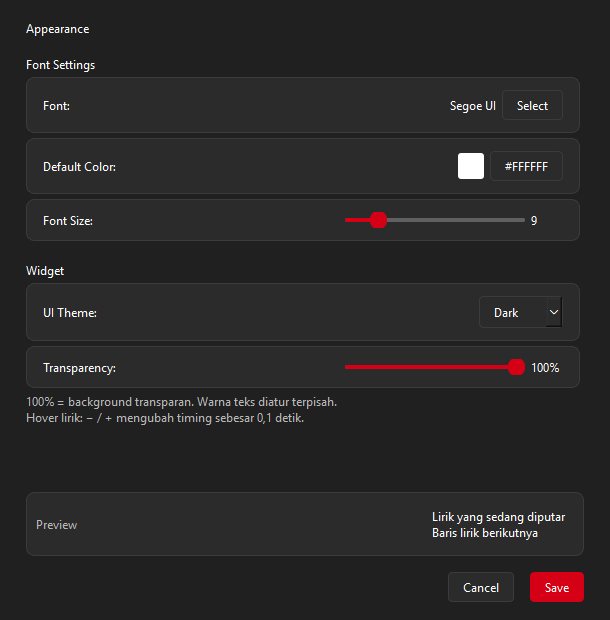

<p align="center">
  
</p>

# GlanceLyric

[](LICENSE)


**Read Spotify lyrics on your Windows taskbar while you work.**

GlanceLyric displays two lines of synchronized lyrics beside the system tray.
It reads Spotify's media session through Windows and fetches lyrics from
[LRCLIB](https://lrclib.net).

[Official website](https://ggdealstore.site/glancelyric) · [Source](https://github.com/ddmmyy94/GlanceLyric) · [Install](#install) · [Features](#features) · [Quick start](#quick-start) · [FAQ](#faq) · [Support](#support-glancelyric)

## Install

**Windows pre-release, v1.1.1.** This release adds update notices at Windows
login, playback-clock fixes, and a direct SociaBuzz support menu. Automated
layout, update, package, and portable runtime checks have passed. Installer
upgrade, uninstall, login autostart, and Spotify on other PCs still need manual
validation.

The [v1.1.1 pre-release](https://github.com/ddmmyy94/GlanceLyric/releases/tag/v1.1.1)
is available with the installer, portable ZIP, and SHA-256 checksums. GlanceLyric
remains free to download and use, with no donation required.

### Windows installer

Download [**`GlanceLyric-Setup-1.1.1-x64.exe`**](https://github.com/ddmmyy94/GlanceLyric/releases/download/v1.1.1/GlanceLyric-Setup-1.1.1-x64.exe) and run it.
The installer installs the app for your Windows account, adds a Start Menu
shortcut, and offers optional desktop and autostart shortcuts/settings.
You do not need to install Python or run the installer as Administrator.

**Requirements:** Windows 10 version 1809 or newer, or Windows 11, on an x64 PC;
the Spotify desktop app; an internet connection to fetch uncached lyrics.

### Portable ZIP

Download [**`GlanceLyric-v1.1.1-windows-x64.zip`**](https://github.com/ddmmyy94/GlanceLyric/releases/download/v1.1.1/GlanceLyric-v1.1.1-windows-x64.zip), extract it,
and run `GlanceLyric.exe` inside the `GlanceLyric` folder. Keep `_internal` beside
the executable. The ZIP includes Python and Qt.

Download [SHA256SUMS.txt](https://github.com/ddmmyy94/GlanceLyric/releases/download/v1.1.1/SHA256SUMS.txt)
and compare the package's SHA-256 before running it. Both executables are unsigned.

### Updating from v1.0

**v1.0 cannot notify you about updates.** Download v1.1.1 manually once, close
the old widget and its watcher, then run the new installer. For portable use,
extract the new ZIP into a separate folder and run its `GlanceLyric.exe`.
Keep `_internal` with the executable; do not mix files from different versions.
Settings and the lyric cache stay in `%USERPROFILE%\.glancelyric`.

Starting with v1.1.0, the app can notify you about later releases. This is an
update notification, not an automatic installer. See [Updates](#updates).

### WinGet (planned)

The package is **not yet available in the WinGet community repository**.
After the package submission is accepted, you will be able to install it with:

```powershell
winget install --id ddmmyy94.GlanceLyric --exact --source winget
```

Until then, use the installer or portable ZIP above.

## Features

- **Two-line synchronized lyrics** on the taskbar, with each pair staying in
  place until the next lyric block.
- **Windows media integration** for the Spotify desktop app, without a Spotify
  developer account or API key.
- **Appearance settings** for fonts, text size, colors, theme, and transparency.
- **Timing adjustment** in 0.1-second steps when the lyrics run early or late.
- **Optional autostart:** a background watcher opens the widget when a new
  Spotify process session starts. From v1.1.1, new installer setups select it
  by default; you can change it in Settings. Upgrades retain your installer choices.
- **Taskbar placement** to the left of the tray, with space for NetSpeedTray
  when GlanceLyric detects it. Fonts shrink to fit a small horizontal taskbar
  and grow back as space allows, without changing your saved preference.
- **Update notices** with version numbers and release notes, plus a manual
  **Check for updates…** menu action.
- **Support this Project** opens the maintainer's SociaBuzz page in your browser.
- **Local settings and lyric cache** in `%USERPROFILE%\.glancelyric`.

### Screenshots




Application screenshots with sample lyrics, not a live Spotify playback session.

## Updates

From v1.1.1, the Windows-login watcher checks public GitHub releases without
waiting for Spotify or the lyric widget. Enable **Start with Windows** and
automatic checks in Settings to receive these notices. Windows must allow
GlanceLyric in **Settings → Apps → Startup**. A powered-off PC cannot receive
notices; checks start after you sign in and need an internet connection.

The update window shows your installed version, the newer version, and scrollable
release notes. **Download** opens the official GitHub release in your browser;
you download and run the installer yourself. **Not Now** dismisses the notice
until the next Windows-login watcher session. **Skip This Version** suppresses
that version; later releases can still notify you. A manual check can show a
skipped release. The widget and watcher share a lock to avoid duplicate notices.

After a successful request, automatic checks wait at least one hour. At login,
the watcher checks again even if the last check was recent. Offline checks retry
every five minutes while the app is running. Automatic failures do not open error
windows or interrupt lyrics.

Use **Check for updates…** from the right-click menu whenever you want, or turn
off automatic checks in Settings. Early-testing builds include published
pre-releases and label them as such; stable builds exclude pre-releases.

There is no notification when the installed version is already up to date.
Older binaries keep their old behavior: v1.0 has no update checker, and v1.1.0
checks only while the widget is open, at most once per day. Install v1.1.1 once
after its release to get login notices and these fixes. Downloading a ZIP alone
does not install a startup task; portable users must enable **Start with Windows**.

## Quick start

1. Launch **GlanceLyric** from the Start Menu or the extracted folder.
2. Play a song in the Spotify desktop app.
3. Right-click the widget and choose **Settings** to adjust its appearance.
4. Hover over the widget and use `+` / `−` to adjust lyric timing. You can also
   use `←` / `→`, hold `Shift` for 0.5-second steps, or press `Ctrl+0` to reset.
5. Choose **Exit** from the context menu to close the widget.

The autostart watcher respects **Exit** for the current Spotify process session.
Launch GlanceLyric yourself or restart Spotify to show it again.

## FAQ

### Do I need Python?

No. The release packages include the runtime.

### Does it work with Spotify in a browser?

The current version targets the Spotify desktop app. Browser playback is not supported.

### Why are some lyrics missing or out of sync?

LRCLIB may not have synchronized lyrics for a song, or its metadata may differ
from Spotify's. Use the timing controls for a fixed offset. An instrumental
track or a track without synchronized lyrics may not show timed lines.

### What data leaves my computer?

GlanceLyric reads the current Spotify media metadata and playback state from
Windows. To find lyrics, it sends song lookup metadata such as the title and
artist to LRCLIB over the internet. From v1.1.0, update checks also request public
release metadata from GitHub, without song information. Settings and cached lyrics live in
`%USERPROFILE%\.glancelyric`. See the [privacy notes](PRIVACY.md).

### How do I enable or disable autostart?

Use **Settings → Start with Windows** (v1.1.1), select the autostart task in the installer,
or run these commands from the
folder containing `GlanceLyric.exe`:

```powershell
.\GlanceLyric.exe --install
.\GlanceLyric.exe --uninstall
```

From v1.1.1, the first command also starts the watcher immediately. The second
command removes the autostart registration; it does not uninstall
the application. Disabling startup applies to subsequent Windows logins. To stop an
existing watcher immediately, end its GlanceLyric process in Task Manager.

### How do I uninstall it?

For the Setup edition, open **Windows Settings → Apps → Installed apps →
GlanceLyric → Uninstall**. Close the widget and stop its background watcher
before uninstalling. For the portable edition, disable autostart, close its
processes, and delete the extracted folder.

The uninstaller keeps `%USERPROFILE%\.glancelyric`. Delete that folder yourself
if you want to remove settings and cached lyrics too.

### Why might Windows show an unknown-publisher warning?

The current build configuration produces unsigned executables. Windows may
show a SmartScreen warning. Download releases from this project's GitHub
repository and check the release's SHA-256 hashes in `SHA256SUMS.txt`.

## Support GlanceLyric

GlanceLyric is free and open source. You can support the project by
[starring the repository](https://github.com/ddmmyy94/GlanceLyric),
[reporting a bug](https://github.com/ddmmyy94/GlanceLyric/issues), or contributing a fix.

[Support GlanceLyric on SociaBuzz](https://sociabuzz.com/ddmmyy94/tribe)

Donations are optional and are never required to download, install, or use the
app. SociaBuzz handles payments on its own website; no payment takes place in
GlanceLyric.

## Build from source

Use 64-bit Python compatible with the dependencies. The local v1.0 build used
Python 3.14. Install [Inno Setup 6.3 or newer](https://jrsoftware.org/isinfo.php)
if you also want to build `Setup.exe`.

Clone the source, then build:

```powershell
git clone https://github.com/ddmmyy94/GlanceLyric.git
cd GlanceLyric
.\Build.bat
.\.venv\Scripts\python.exe test_glance.py
.\.venv\Scripts\python.exe test_updates.py
.\.venv\Scripts\python.exe test_update_ui.py
.\.venv\Scripts\python.exe test_timing.py
.\.venv\Scripts\python.exe test_taskbar.py
.\.venv\Scripts\python.exe test_release.py
```

`Build.bat` creates a virtual environment, installs the dependencies, converts
`assets/glancelyric.png` into a multi-size ICO, and builds the executable and
portable ZIP. If it finds `ISCC.exe` on PATH or in a standard Inno Setup 6
installation directory, it builds the installer too. Output goes to `dist/`.
`test_release.py` checks both package hashes, ZIP integrity, notices, and the
README's bundled assets; it requires a completed installer and portable build.
The current source builds v1.1.1 packages, not replacements for older release assets.

To run from source after installing dependencies:

```powershell
.\.venv\Scripts\pythonw.exe glancelyric.pyw
```

See [RELEASING.md](RELEASING.md) for GitHub release, WinGet submission, and
donation setup instructions.

## Contributing

[Open an issue](https://github.com/ddmmyy94/GlanceLyric/issues) with your Windows version, GlanceLyric version, Spotify
version, and steps to reproduce the problem. For lyric problems, include the
song title and artist. Pull requests are welcome.

## Credits

- [LRCLIB](https://lrclib.net) for the lyric service.
- Python, PySide6 / Qt, Requests, PyWinRT, PyInstaller, and Inno Setup.
- [NetSpeedTray](https://github.com/erez-c137/NetSpeedTray) for taskbar-app and
  README presentation inspiration.
- GlanceLyric logo supplied by the project maintainer.

GlanceLyric is an independent project and is not affiliated with Spotify.

## License

GlanceLyric's application code is available under the [MIT License](LICENSE).
You may use, modify, and redistribute it, including commercially, while keeping
the required copyright and license notices. Dependencies retain their own
licenses; see [THIRD-PARTY.md](THIRD-PARTY.md).
